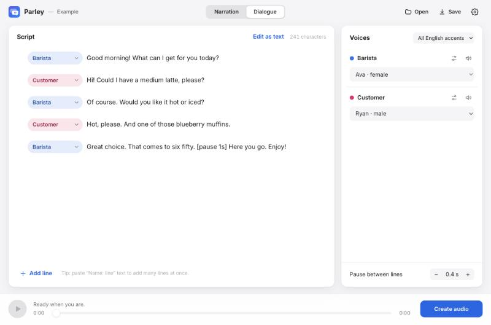

<p align="center"></p>
<h1 align="center">Parley</h1>
<p align="center">Turn English texts and multi-character dialogues into natural-sounding audio.<br>
Free · Windows 10/11 · made for English teachers</p>

<p align="center"></p>

## Download

1. Go to the [latest release](https://github.com/arkayaga/parley/releases/latest) and download **ParleySetup.exe**.
2. Run it. No administrator rights are needed; Parley installs for the current user and adds Start menu and desktop shortcuts.
3. Windows may say *"Windows protected your PC"* because the installer is not code-signed. Click **More info → Run anyway**.

Parley updates itself: when a new version is published, a bar at the top of the window offers to install it.

## What it does

- **Narration or dialogue.** Read a single text with one voice, or write a conversation line by line and give every character their own voice.
- **47 English neural voices in 14 accents**: American, British, Australian, Canadian, Indian, Irish, New Zealand, South African and more. 300+ voices in other languages can be switched on in Settings.
- **Voice profiles.** 43 ready-made roles for everyday classroom dialogues (Teacher, Student, Waiter, Customer, Receptionist, Doctor, Interviewer and more), each with its own voice. A character named after a profile gets that voice automatically; "Student A" and "Student B" get two different voices. Edit, delete or add your own profiles; they are kept on the computer and can be exported to share with colleagues.
- **Per-character speed and pitch.**
- **Listen before you save.** The audio plays inside the app and highlights the line being spoken. Click ▶ next to any line to jump to it.
- **Save as MP3**, plus optional **subtitles (.srt)** with sentence timings.
- **Pauses:** type `[pause]`, `[pause 2s]` or `[pause 500ms]` anywhere in a line.
- **Paste or open scripts** written as `Name: line`. Lines without a name continue the previous speaker.
- **Read text from an image** (a screenshot of a coursebook page, for example). This uses the text recognition built into Windows; images never leave the computer.
- **Projects** (`.parley` files) keep the script, voices and settings together.
- **Fast edits.** Unchanged lines are cached, so fixing one line only re-creates that line.

Keyboard: `Ctrl+Enter` create audio · `Space` play/pause · `Ctrl+S` save project · `Ctrl+O` open.

## Privacy

To create audio, the text of your script is sent to Microsoft's online speech service (the same service the Edge browser uses for *Read aloud*). Nothing else is sent anywhere. Parley is free and independent; it is not a Microsoft product, and Microsoft may change or limit the service at any time.

## How updates work

Parley depends on a free but unofficial speech service, which sometimes changes how it accepts connections. Parley handles that in two ways:

| What happens | What Parley does | What you need to do |
|---|---|---|
| The speech service changes and starts refusing connections | Downloads the newest version of its speech engine ([edge-tts](https://pypi.org/project/edge-tts/)) from PyPI, verifies it, tests it and switches to it. This also works from **Settings → Speech engine → Repair**. | Nothing |
| A new Parley version is published here | Shows "Parley x.y is available" and installs it with one click | Click **Update** |

---

## For developers

Parley is a small Python app: a [pywebview](https://pywebview.flowrl.com/) window (Edge WebView2 on Windows) with a plain HTML/CSS/JS interface in `ui/`, and Python modules in `parley/`:

| Module | Purpose |
|---|---|
| `main.py` | Window and the API the interface calls |
| `script.py` | `Name: line` parsing, chunking, `[pause]` tags, text file decoding |
| `tts.py` | Speech synthesis with retries, cancellation and caching |
| `audio.py` | Joins MP3 clips frame by frame and inserts silence, without re-encoding |
| `engine_update.py` | Runtime self-repair of the speech engine from PyPI |
| `updater.py` | App updates from GitHub Releases |
| `ocr_win.py` | Text recognition through `Windows.Media.Ocr` |
| `project.py` | `.parley` project files and settings |

### Run from source

```bash
python -m venv .venv
.venv/bin/pip install -r requirements.txt -r requirements-dev.txt   # Windows: .venv\Scripts\pip
.venv/bin/python -m parley
```

The app also runs on macOS for development (image reading is Windows-only).

### Tests

```bash
python -m pytest            # unit tests
python -m pytest -m live    # talks to the real speech service
python tests/e2e_app.py     # opens the real window and creates audio through the UI
```

### Releasing a new version

Every push to `main` is built on GitHub's Windows runners (see `.github/workflows/build.yml`); the installer is attached to the run as an artifact.

To publish a release that installed copies will offer as an update:

1. Change `VERSION` in `parley/version.py` (for example `1.0.1`) and commit.
2. Tag and push:
   ```bash
   git tag v1.0.1
   git push origin main --tags
   ```

The workflow tests the code, builds `ParleySetup.exe`, self-tests the built app and creates the GitHub Release with the installer and its SHA-256 checksum.

A weekly workflow (`edge-tts-watch.yml`) checks PyPI for a newer edge-tts, runs the live speech test against it and opens a pull request that bundles it. For it to open pull requests, enable **Settings → Actions → General → Allow GitHub Actions to create and approve pull requests** in this repository.

## License

MIT for Parley's own code. Bundled open-source components keep their own licenses; see `THIRD_PARTY_NOTICES.txt` (also available in the app under **Settings → Licenses**). The Inter typeface is used under the SIL Open Font License.
